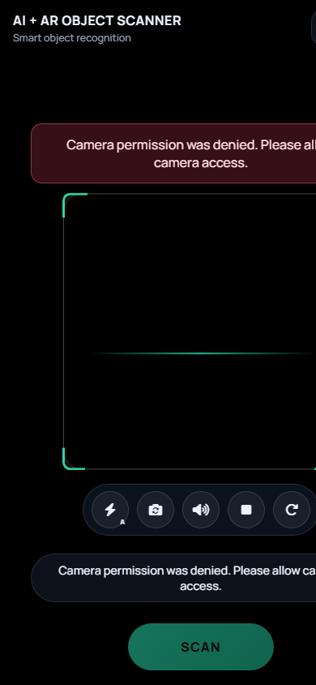
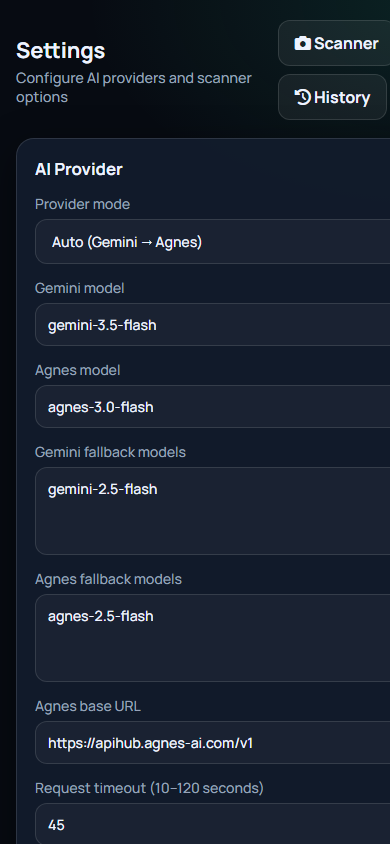
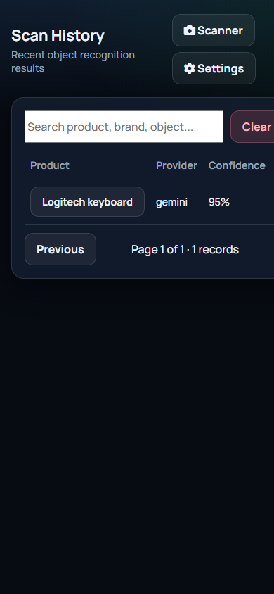

# AI + AR Smart Object Recognition System

A mobile-first web app that uses your phone camera, sends a captured frame to AI Vision (Gemini and/or Agnes), then shows an AR-style detection box and product information overlay.

[](LICENSE)

## Screenshots

| Scanner | Settings | History |
| --- | --- | --- |
|  |  |  |

More notes: [docs/screenshots/README.md](docs/screenshots/README.md)

## 1. Project Overview

Point your smartphone camera at a physical object, tap **SCAN**, and the system:

1. Captures and compresses the camera frame  
2. Sends it securely to a PHP backend  
3. Runs AI object / product recognition  
4. Optionally enriches the result with a conservative web lookup  
5. Draws a bounding box + tappable info card on the live camera view  

## 2. Features

- Live rear-camera preview (MediaDevices API)
- Canvas capture with resize (max 1280px) and JPEG compression (~0.70)
- Gemini Vision + Agnes Vision providers
- Provider modes: **Auto**, **Gemini**, **Agnes**
- Model + fallback model configuration
- Connection test from Settings
- AR-style bounding box and expandable product card
- Stage-based recognition progress UI
- Optional MySQL scan history
- QR code to open the scanner on a phone
- API keys stored only on the server (never in frontend JS)

## 3. Technology Stack

- PHP 8.3+ (PDO, cURL)
- MySQL 8+ (optional history)
- HTML5 / CSS3 / Vanilla JavaScript
- Bootstrap not required (custom mobile UI)
- Font Awesome + Google Fonts (CDN)
- Browser MediaDevices, Canvas, Fetch APIs

## 4. Requirements

- XAMPP (Apache + PHP 8.3+) or similar / cPanel shared hosting
- PHP extensions: `curl`, `json`, `pdo_mysql` (if using history), `mbstring`, `gd` recommended
- Gemini and/or Agnes API key
- HTTPS for real-device camera access (localhost is allowed as a secure exception)

## 5. XAMPP Installation

1. Copy this project folder into `C:\xampp\htdocs\`
2. Example path:

```text
C:\xampp\htdocs\AI+AR_object_recognition_system\
```

3. Copy config:

```text
config/config.example.php  →  config/config.php
```

(Already included as a blank starter `config.php` in this package.)

4. Start **Apache** in XAMPP (and **MySQL** if you want history).
5. Open:

```text
http://localhost/AI+AR_object_recognition_system/
```

or

```text
http://localhost/AI+AR_object_recognition_system/index.php
```

6. Go to **Settings**, paste your API key(s), save, then **Test Connection**.

> Tip: If you prefer a shorter URL, rename the folder to `ai-ar-object-recognition`.

## 6. cPanel Installation

1. Upload the project into `public_html/` or a subdirectory, for example:

```text
public_html/ai-ar/
```

2. Ensure `config/config.php` exists and is writable by PHP if you want Settings page saves.
3. Protect sensitive folders (`.htaccess` files are included for `config/`, `includes/`, `storage/`, `database/`).
4. Visit:

```text
https://your-domain.com/ai-ar/
```

Paths are subdirectory-safe (no hard-coded domain root).

## 7. HTTPS Requirement

Browsers only expose the camera in a **secure context**:

- `https://...`
- or `http://localhost` / `http://127.0.0.1`

For phone testing over LAN IP (`http://192.168.x.x`), camera access will usually fail. Use HTTPS, a tunnel (e.g. Cloudflare Tunnel / ngrok), or deploy to hosting with SSL.

The Settings page shows a QR code built from the current app URL.

## 8. AI API Configuration

Edit `config/config.php` or use **Settings**:

| Key | Description |
| --- | --- |
| `ai_provider` | `auto` \| `gemini` \| `agnes` |
| `gemini_api_key` | Google AI Studio / Gemini key |
| `gemini_model` | e.g. `gemini-2.0-flash` |
| `gemini_fallback_models` | newline-separated fallbacks |
| `agnes_api_key` | Agnes API key |
| `agnes_model` | e.g. `agnes-2.5-flash` |
| `agnes_fallback_models` | newline-separated fallbacks |
| `agnes_base_url` | default `https://apihub.agnes-ai.com/v1` |
| `request_timeout` | 10–120 seconds |

### Auto mode

1. Try Gemini (if key present)  
2. If Gemini fails / incomplete → try Agnes  

### Security

- Keys are never returned by APIs
- Settings only shows `Key saved` / `Not configured`
- `config/config.php` is gitignored and blocked by `.htaccess`

## 9. Database Setup (optional)

1. Import `database/database.sql` in phpMyAdmin / MySQL.
2. Copy values from `database/database.example.php` into `config/config.php` (replace `YOUR_DB_PASSWORD`).
3. Set `db_enabled` to `true` (or enable the checkbox in Settings and save).
4. Open `history.php` to browse scans.

History stores labels/metadata only — **not** camera images.

## 10. Camera Permission

On first open, allow camera access when the browser prompts you.

Friendly errors include:

- Camera permission is required.
- Camera is unavailable.
- Please use HTTPS to access the camera.

## 11. Testing

1. Configure at least one AI key in Settings → **Test Connection**.
2. Open the scanner on a phone (HTTPS).
3. Point at a clear object / product with visible branding.
4. Tap **SCAN**.
5. Confirm:
   - Progress stages appear
   - Bounding box overlays the object
   - Card expands with manufacturer / specs / confidence / provider
   - **SCAN AGAIN** resets and allows another scan

### Desktop

Works in Chrome / Edge with a webcam. Prefer the environment camera on phones.

## 12. Troubleshooting

| Problem | Fix |
| --- | --- |
| Camera blocked | Use HTTPS or localhost; check site permissions |
| `AI provider is not configured` | Add Gemini and/or Agnes key |
| Gemini / Agnes auth failed | Verify key + model name |
| Timeout | Increase timeout in Settings (up to 120s) |
| Settings won’t save | Make `config/config.php` writable |
| History 503 | Enable DB + import SQL + set `db_enabled` |
| Blank recognition | Improve lighting / fill the scan frame / retry |

Check logs (no secrets should appear):

```text
storage/logs/app.log
```

## 13. Security Notes

- Do not commit real API keys
- Treat AI JSON as untrusted input (validated/normalized server-side)
- Image payload validated (Base64, MIME, size)
- Sensitive directories denied via `.htaccess`
- Optional `settings_token` in config can lock Settings API writes

## 14. Project Folder Structure

```text
AI+AR_object_recognition_system/
├── index.php
├── settings.php
├── history.php
├── README.md
├── LICENSE
├── .htaccess
├── .gitignore
├── api/
│   ├── recognize.php
│   ├── settings.php
│   ├── translate.php
│   └── history.php
├── config/
│   ├── config.example.php   ← commit this
│   └── config.php           ← gitignored (real keys)
├── includes/
│   └── ...
├── assets/
│   ├── css/app.css
│   └── js/
│       └── ...
├── database/
│   ├── database.sql
│   └── database.example.php
├── docs/
│   └── screenshots/
└── storage/
    ├── logs/
    ├── cache/
    └── data/
```

## Quick Start Checklist

1. Apache running  
2. Open Settings → add API key → Save → Test Connection  
3. Open Scanner → allow camera → SCAN  

Built for XAMPP, cPanel, and subdirectory HTTPS deployments.
